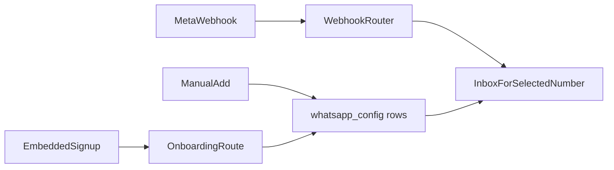

# Multi-number WhatsApp in WACRM

Connectly is a single shared inbox: many WABAs, Embedded Signup, Coexistence echoes, and a number switcher. WACRM is the CRM that replaces it. It already has the shared inbox, 24-hour reply window, AES-256-GCM tokens, and HMAC webhook checks. It does **not** allow more than one number: [`whatsapp_config_account_id_key`](supabase/migrations/017_account_sharing.sql) is `UNIQUE (account_id)`, and send paths load that row with `.maybeSingle()` ([`src/lib/whatsapp/send-message.ts`](src/lib/whatsapp/send-message.ts)).

Keep the table name `whatsapp_config`. One row becomes one phone number. Existing one-number workspaces stay valid: their only row is marked default and every conversation and contact is backfilled to it.

## 1. Schema

New migration `supabase/migrations/047_multi_whatsapp_numbers.sql`.

- Drop `whatsapp_config_account_id_key`.
- Add to `whatsapp_config`: `display_phone_number`, `verified_name`, `is_on_biz_app` (Coexistence), `is_default`, `source` (`manual` or `embedded_signup`). Partial unique index: one `is_default` per `account_id`. Backfill the existing row as default.
- `conversations.whatsapp_config_id` FK. Replace [`idx_conversations_account_contact`](supabase/migrations/036_conversation_contact_dedup.sql) with unique `(account_id, whatsapp_config_id, contact_id)` so the same customer can have a separate thread on each line.
- `contacts.whatsapp_config_id` FK. Replace [`idx_contacts_account_phone_normalized`](supabase/migrations/022_contact_phone_dedup.sql) with unique `(account_id, whatsapp_config_id, phone_normalized)`. The contacts list for a selected number only shows that number's people.
- `message_templates.waba_id` so template sync and submit stay on the number's WABA.
- `broadcasts.whatsapp_config_id` so a broadcast sends from one line and only to that line's contacts.
- Widen `messages.content_type` to include `unsupported` (and `sticker`, which the webhook already sees).

RLS stays account-membership based. No new tenant table.

## 2. One resolver for every send path

Add `src/lib/whatsapp/resolve-config.ts`. Lookup order:

1. Explicit config id
2. `conversation.whatsapp_config_id`
3. `contact.whatsapp_config_id`
4. The account's `is_default` row

Replace every `.eq('account_id').single()` / `.maybeSingle()` on `whatsapp_config`. Call sites include send, react, media, templates, broadcasts, automations ([`src/lib/automations/meta-send.ts`](src/lib/automations/meta-send.ts)), flows ([`src/lib/flows/meta-send.ts`](src/lib/flows/meta-send.ts)), document delivery, and [`src/lib/inbox/whatsapp-connection.ts`](src/lib/inbox/whatsapp-connection.ts). Inbound automations and flows follow the conversation's number. Document delivery and the Razorpay desk notification keep using the default number.

A workspace with one number behaves as it does today.

## 3. Numbers in Settings

Turn [`src/components/settings/whatsapp-config.tsx`](src/components/settings/whatsapp-config.tsx) into a list: display number, name, WABA, source, Coexistence, subscribed, default. Keep manual add (phone number id, WABA id, token). Subscribe with the existing `subscribeWabaToApp` helper.

Registration rule from Connectly: call `POST /{phone}/register` with the 6-digit PIN only when `is_on_biz_app` is false. Coexistence numbers skip the PIN. [`src/lib/whatsapp/meta-api.ts`](src/lib/whatsapp/meta-api.ts) already has register and subscribe; read Graph version from `META_GRAPH_API_VERSION` (fallback `v21.0`; Architech sets `v26.0`).

Actions per row: set default, refresh from Graph, subscribe, disconnect that row only.

## 4. Embedded Signup

Settings gets a Connect WhatsApp button. The browser loads the Facebook JS SDK and calls `FB.login` with `config_id`, `response_type: 'code'`, and `extras: { version: 'v4', sessionInfoVersion: '3', featureType: 'whatsapp_business_app_onboarding' }`.

New `POST /api/whatsapp/onboarding` (session required, settings permission):

1. Exchange the code server-side for a business token (`META_APP_ID`, `META_APP_SECRET`). Never return the token.
2. `POST /{waba}/subscribed_apps`.
3. `GET /{waba}/phone_numbers` and upsert one `whatsapp_config` row per phone, token encrypted with the existing [`encrypt`](src/lib/whatsapp/encryption.ts).
4. If the number is on the Business app, `POST /{phone}/smb_app_data` for `smb_app_state_sync`, then `history`. Do not register a PIN.

Public env for the SDK only: `NEXT_PUBLIC_META_APP_ID`, `NEXT_PUBLIC_META_CONFIG_ID`. Webhook GET also accepts `META_WEBHOOK_VERIFY_TOKEN`, because a tech-provider app has one verify token for every number. Per-row tokens still work.

## 5. Coexistence webhooks

[`src/app/api/whatsapp/webhook/route.ts`](src/app/api/whatsapp/webhook/route.ts) today handles `messages`, statuses, and template fields. Add:

- `smb_message_echoes`: store as outbound messages on that number's conversation (sent from the phone app). Dedup on `wa_message_id` / `message_id`.
- `smb_app_state_sync`: create or rename the contact on that number.
- `history`: import threads onto the same conversation, skipping ids already stored.
- `unsupported`: save the row and show "Unsupported message, open on phone" in the bubble.

Route every event by `metadata.phone_number_id`, which the webhook already does.

## 6. Inbox switcher

Add a number switcher on [`src/app/(dashboard)/inbox/page.tsx`](<src/app/(dashboard)/inbox/page.tsx>). Persist the choice in the `?n=` query and localStorage. Conversation list, thread, composer, and contact sidebar read only the selected number. The 24-hour window in [`src/components/inbox/message-thread.tsx`](src/components/inbox/message-thread.tsx) stays. Templates and the broadcast wizard use the same selection and refuse to send if no number is selected.

Contacts, pipelines, and deals pages filter to the active number the same way, so one client's people do not show up while another line is selected.

## Out of scope

- Copying Connectly's Neon database into Supabase. Connectly stays the live inbox until this is deployed and the Meta webhook is moved.
- Editing the Meta app from code. After deploy, point the webhook, OAuth redirect, and JS SDK domain at WACRM, and subscribe `messages`, `smb_message_echoes`, `smb_app_state_sync`, and `history`. Leave the Connectly app id and Embedded Signup config id as they are.
- Separate client logins, ads, or the Marketing API.

## Verification

Unit tests for the resolver, onboarding step order (mocked Graph), Coexistence skip-PIN, echo/history dedup, and the unsupported label. Then exercise Settings and the inbox switcher in the browser: add stays on the selected number, and a second number does not show the first number's chats.
